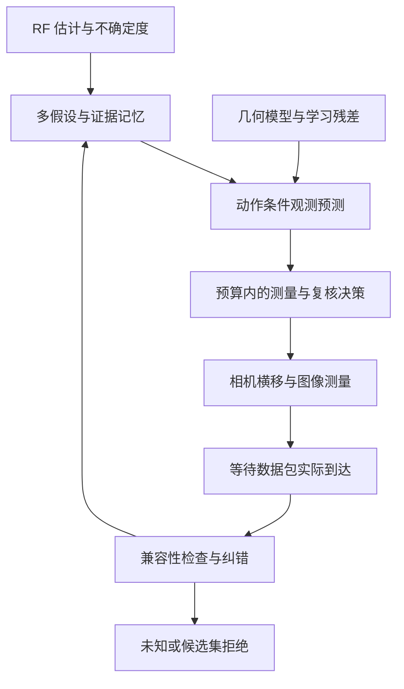

# 2026-11-03 组会：ISAC 世界模型的主动求证与纠错

**用途：**六页、约 8–10 分钟的口头汇报提纲。先展示已实现的研究链路与证据，再请导师确认下一步问题和评价标准。

**汇报前核对，不必放在投影上：**2026-11-02 开始审查时，可核对的原研究分支为 `9229f572325dff13377b58c8462cc006c0f0db97`，未看到 10 月 28 日之后的新增远端提交；这只说明用户的新进度尚未同步可见，不代表没有本地进展。该提交此前的 [CI 40702495794](https://github.com/billlza/isac-world-model/actions/runs/40702495794) 已通过。本次另行实现求证修复、成对实验脚本及 H200 首跑脚本；新实验结果与完整 CI 以本次分支的实际记录为准。

## 第 1 页｜研究问题已经收敛（约 1 分钟）

### 页面要点

- 任务：有限时间、通信和感知资源下，维护多个环境解释，并选择下一次求证操作。
- 研究问题：历史记忆与动作条件预测，能否让新证据更有效地纠正错误判断、减少无效测量？
- 本次目标：用已有实现和失败案例，请导师确认下一阶段研究重点。

### 可以这样讲

“我的研究问题现在收敛到：观测可能晚到、不完整，也可能相互矛盾时，模型怎样保留竞争解释，预测下一次测量会带来什么，再决定是否值得测。当前已经有一个从头训练的小型主动观测闭环。我希望先把推理、求证和纠错这条链做扎实，再检验学习机制相对经典方法的增益。”

**English:** *My focus is multi-hypothesis prediction, active verification and evidence-based correction under time and resource constraints.*

## 第 2 页｜已经实现的证据链（约 1.5 分钟）

### 页面要点

1. 共享 MIMO-OFDM 仿真与匹配估计器给出初始 RF 估计。
2. 提出同深度／更远目标两个解释，预测候选相机视点下的方位观测。
3. 执行相机横移，渲染独立的合成透视图像并提取新方位。
4. 观测到达后更新相对支持、GRU 记忆与反证状态，允许保持未知。

### 可以这样讲

“这条链已经实际执行，预测保存在测量之前，观测在可用时刻之前不能更新判断。学习模块从随机初始化开始，在几何模型上学习观测残差、尺度和小型 GRU 记忆。测试包括晚到、相机失效、不可辨识和两个候选都错误等情况；新证据推翻初始错误偏好的路径也有专项测试。”

“当前动作是改变相机视点，学习输入是提取后的方位。通信开销仍是初始 OFDM 原始载荷与相机消息的资源代理；下一步才把持续 RF 观测和联合资源动作进一步接起来。”[1][2]

**English:** *Predictions are recorded before measurement, and belief updates use only evidence that has actually arrived.*

## 第 3 页｜已有比较结果怎样影响选型（约 1.5 分钟）

### 页面要点

| 实验及条件 | 已有结果 | 对研究的含义 |
| --- | --- | --- |
| 旧 ToyScene 正常场景 | IMM 0.232 m；结构化＋Attention 0.266 m RMSE | 简单条件下经典方法是强参照 |
| 旧 ToyScene 无线离群点 | 门控 IMM 0.438 m；结构化＋Attention 1.219 m RMSE | 异常处理必须有强对照 |
| 新主动观测实验 | 有记忆验证 NLL 1.353907；无记忆 1.305643，越低越好 | 本轮未证实记忆优越 |

新实验规模：64 个训练 episode、16 个验证 episode；6 场景 × 6 方法 × 每场景 4 个测试 seed，共 **144 次 rollout**。旧跟踪实验与新方位求证实验的数据和任务不同，不能混成一张性能排行榜。[1][3]

### 可以这样讲

“这些结果帮助我确定了研究切入点。KF、IMM 和几何 VoI 是评价参照，主学习模型没有用它们的预训练权重或教师输出。几何先验仍然保留，真正要检验的是学习残差与历史记忆增加了什么能力。目前不能说 GRU 已经更好，但主动求证、因果时间接口和负例测试已经实现。”

**English:** *Classical estimators are strong comparators. The current experiment does not yet establish an advantage from recurrent memory.*

## 第 4 页｜一个具体失败：测量价值与确认程序错位（约 1.5–2 分钟）

### 页面要点

- 旧准则只计算两候选分类错误的预期下降。
- 一次强观测后相对权重可能饱和，算法停止测量；确认／拒绝程序却仍需要第二份证据。
- 已记录结果：有记忆方法在 `same` 中 75% 最终弃答；在 `outside_candidates` 中保持未知，未完成明确拒绝。固定测量能够获得更多证据，也花费更多资源。[1]

### 可以这样讲

“我找到一个可以直接修复和验证的机制问题：调度器认为已经没有多少二分类收益，但证据程序其实尚未完成。本次补丁加入显式复核步骤，在原有截止时间与路程预算内追加检查，不降低确认门槛。同时区分累计反证和连续反证，避免所有候选都解释不了观测时，反而强化相对第一名。”

“原动作准则和新复核准则共用同一个证据状态更新，做配对比较。这里检验的是流程修复带来的判断完成率和额外成本，尚不称作最优 VoI。反证后要求两条新检测与候选集合兼容；历史权重仍然保留，因此这不等于两条检测都支持最后胜出的同一个候选。”

**English:** *The current stopping rule can terminate before the confirmation protocol is complete. I am testing a verification-aware correction while retaining the original action rule as a control.*

**当前状态：代码与专项测试已加入。** 不把尚未取得的物理实验或 GPU 结果写成已改善的数值。

| 汇报前更新项 | 当前记录 |
| --- | --- |
| 新源码提交或明确工作版本 | 本次 `research/verification-2026-11-02` 分支 |
| 本地专项验证 | 求证状态 9 项、H200 预检逻辑 14 项通过；H200 测试使用硬件 mock |
| 因果时间、神经门控及完整集成验证 | 已加入回归测试；由新提交的完整 CI 实跑 |
| 相同种子、状态规则下的旧／新动作准则结果 | 预设 8 seed × 6 场景 × 2 准则；保留所有失败与实际资源开销 |
| 新提交的远端 CI | 待验证；旧绿灯不替代新提交验证 |

## 第 5 页｜下一阶段实验与 HPC 的具体用途（约 1–1.5 分钟）

### 页面要点

- 先完成上述小修复与配对验证，再增加独立训练种子和测试轨迹。
- 同一观测序列比较预测、记忆和校准；各自选动作时比较风险与实际资源曲线。
- 真实数据先用于检验视觉—无线融合、时序记忆和纠错；可控仿真承担新动作的反事实验证。
- HPC 用于扩大训练与仿真规模；第一步测一小批任务的时间、显存和吞吐，再确定正式预算。

### 可以这样讲

“HPC 账户已经获批，批准截图已有。资源方面，目前我获知的是单 H200；是否独占整卡、可用显存、配额和作业时长还需要在系统上确认。明天我不会把尚未运行的 GPU 结果当作研究成果。算力主要服务于多种子验证与更丰富的观测条件，研究问题仍然是记忆和求证何时有价值。”

“即时信念纠错和参数再学习也会分开：先根据到达证据修正当前判断，再用保留的经验在独立训练流程中更新模型，并检验旧场景能力是否退化。”

**English:** *HPC will support larger controlled studies. Resource availability and GPU performance still need to be measured.*

## 第 6 页｜请陈老师确认的三个问题（约 1 分钟）

1. **研究主问题：**是否适合先把贡献集中在“观测实际到达时刻的求证价值，以及多假设记忆的纠错作用”，再逐步扩大到联合 ISAC 资源控制？
2. **第一项主要任务：**下一阶段优先用跟踪／关联风险，还是波束选择／通信性能作为主任务损失，更能体现课题的通信意义？
3. **评价证据：**是否认可先以强经典信念与调度基线、配对资源曲线和失败场景形成第一组完整证据，再开展真实数据迁移与更大规模训练？

### 可以这样收尾

“我希望今天确定下一阶段最值得验证的命题和主要指标。已有实现已经让我能用实验回答具体问题，当前也发现了明确失败机制。我会保留这些负结果，并把修复前后的证据带回来，请老师判断它是否沿着合适的研究方向推进。”

**English:** *I would like your guidance on the primary research question, the task loss, and the evidence needed for the next milestone.*

## 现场追问时的简短回答

**为什么不只用 IMM？** 已有实验确认 IMM 在多种条件下很强。下一步公平检验的是历史条件观测预测与主动求证，不预设学习方法一定赢；经典方法会获得同样的信息、动作权限和预算。

**这是否已经是完整世界模型？** 已经有可学习条件预测、证据记忆和主动求证的小闭环。联合自然图像、持续 RF、多对象状态与资源调度的整体模型仍在推进。

**纠错是否等于再学习？** 当前纠错更新信念与 hidden state。参数再学习需要独立的数据、优化、验证和版本切换，不把两者混为一谈。

**是否证明模型理解人的意图？** 当前实验检验环境假设和测量决策；没有用 RLHF 或其他结果证明“理解人”。

## 证据入口

- [1] [主动观测实验、训练规模及正负结果](https://github.com/billlza/isac-world-model/blob/9229f572325dff13377b58c8462cc006c0f0db97/examples/active_observation/README.md)
- [2] [主动观测源码](https://github.com/billlza/isac-world-model/blob/9229f572325dff13377b58c8462cc006c0f0db97/src/isac_wm/active_observation.py)、[专项测试](https://github.com/billlza/isac-world-model/blob/9229f572325dff13377b58c8462cc006c0f0db97/tests/test_active_observation.py)
- [3] [旧 IMM／结构化模型比较的条件与来源版本](https://github.com/billlza/isac-world-model/blob/9229f572325dff13377b58c8462cc006c0f0db97/docs/IMM_RESULTS_2026-10-27.md)

文档准备于 2026-11-02；新结果的更新以实际源码、运行记录和对应 CI 为准。
